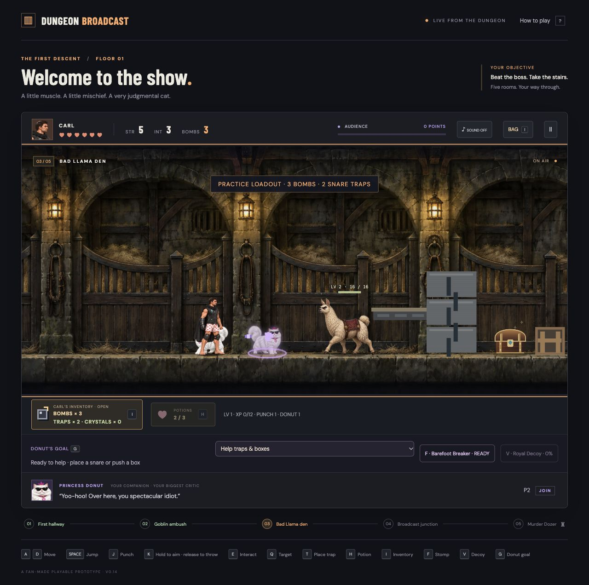

# Dungeon Broadcast

A fan-made dungeon adventure starring Carl and Princess Donut. Punch monsters, plan traps, collect loot, and take on the Murder Dozer—with Donut choosing her own tactics or following your goals.



*Donut’s Royal Decoy in the Bad Llama den.*

## Play locally

```sh
python3 -m http.server 4173 --directory dist
```

Open [localhost:4173](http://localhost:4173). No login or package installation is needed.

To build a standalone HTML file:

```sh
python3 scripts/package_game.py
```

Open `build/Dungeon-Broadcast.html`.

## Source and instructions

- Game code: [`dist/game.js`](dist/game.js), [`dist/index.html`](dist/index.html), and [`dist/style.css`](dist/style.css).
- [Full controls, mechanics, and Mordecai’s practice lessons](README.txt).
- [Artwork notes](ARTWORK.txt).

Run the simulation tests with:

```sh
node --test tests/game.test.cjs
```
